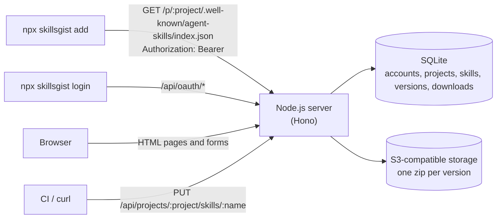

# Contributing

Issues and pull requests are welcome. [PRODUCT.md](PRODUCT.md) and [DESIGN.md](DESIGN.md) record the product decisions and the design system.

## How it works



The server renders every page and serves the discovery index the CLI reads. SQLite holds accounts, projects and their members, skills, versions, the search text and the download log. The bucket holds one zip per version, keyed by its digest. Every download goes through the server, which checks access, records it and streams the zip from the bucket.

```
src/
  server.ts       Node entry: settings, database, storage, GeoIP, hourly maintenance
  app.ts          the Hono app and its middleware
  config.ts       environment settings
  routes/         registry, publishing, skill pages, accounts, downloads
  views/          server-rendered pages (hono/jsx)
  skills/         archive reading and normalization
  db/             schema, migrations and queries (better-sqlite3)
  storage.ts      S3 client
  geoip.ts        country lookup and the DB-IP database download
  render/         SKILL.md to HTML
public/           static assets and fonts
scripts/          verify-cli, screenshots, logo export and test fixture tools
test/             unit and integration tests
```

The schema lives in `src/db/schema.ts` as a list of migrations; the server applies the ones a database has not seen when it starts and records the count in `PRAGMA user_version`. To change the schema, append a migration; never edit one that has shipped.

## Development

You need Node.js 22.12 or later and Docker for a local S3 store.

```bash
npm install
docker run -d --name skillsgist-s3 -p 8333:8333 \
  -e AWS_ACCESS_KEY_ID=skillsgist -e AWS_SECRET_ACCESS_KEY=skillsgist-dev-secret \
  chrislusf/seaweedfs:4.48 mini -dir=/data -master.telemetry=false
cp .env.example .env    # set SESSION_SECRET and S3_SECRET_ACCESS_KEY=skillsgist-dev-secret
npm run dev
```

Open `http://localhost:3000/setup` to create a local admin. `npm run dev` rebuilds the CSS and restarts the server when a file changes; the database lives in `./data`.

```bash
npm test
npm run typecheck
npm run verify:cli
```

The tests use an in-memory database and storage. Set `S3_TEST_ENDPOINT`, `S3_TEST_ACCESS_KEY_ID` and `S3_TEST_SECRET_ACCESS_KEY` to also run the storage tests against a real S3 store, as CI does.

`npm run verify:cli` builds the server, starts it against a throwaway SeaweedFS container and runs the published CLI against it; set `VERIFY_S3_ENDPOINT`, `VERIFY_S3_ACCESS_KEY_ID` and `VERIFY_S3_SECRET_ACCESS_KEY` to use another S3 store instead of Docker. Set `SKILLSGIST_CLI="node ../skillsgist-cli/dist/cli.js"` to test a local build of the CLI, and quote a path that has spaces, as in `SKILLSGIST_CLI='node "../my cli/dist/cli.js"'`.

## Logo and images

`scripts/logo.html` draws the mark on a canvas and previews it at every size. `npm run logo` renders that page in headless Chrome and writes `public/logo.png` (144px, so the 48px mark in the sign-in frame is sharp at 3x; shown at 24px in the nav, 18px in the footer and 48px in the sign-in frame), `public/favicon.png` (64px), `public/favicon.ico` (16, 32 and 48px, for requests that never read a page), `public/apple-touch-icon.png` (180px, square, with the cuts and keyhole filled Paper (#fdfdfc) because iOS turns transparency black) and `docs/images/logo.png` (256px, for the README), and captures `scripts/social-preview.html` twice: as `docs/images/social-preview.png` (1280×640, for GitHub) and, without its command box, as `public/og.png` (1200×630, the `og:image` of every page). Change the drawing, then rerun it; never edit the images by hand.

## Pull requests

Before opening a pull request, run `npm run typecheck` and `npm test`, and run `npm run verify:cli` as well if you touched the registry, publishing or storage code.
