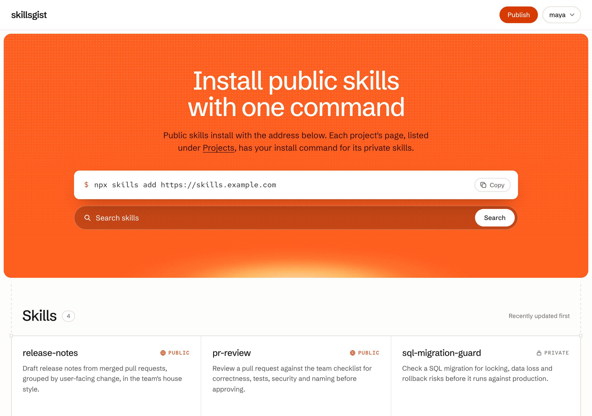

# skillsgist

A private Agent Skills registry you host yourself.

[](https://github.com/Qsnh/skillsgist/actions/workflows/ci.yml)
[](LICENSE)

Keep your team's Agent Skills in one place that only your team can see. Upload a skill in the browser, and anyone with access installs it into Claude Code, Codex, Cursor and dozens of other coding agents with one command:

```bash
npx skillsgist add https://skills.example.com/p/<project>
```



## Is it for you?

skillsgist is a good fit if:

- your team writes its own skills and wants to keep them out of public registries;
- you want them on a server you run, not on someone else's service;
- different groups need different access, and each group decides who sees its skills;
- you would rather manage skills, versions and people in web pages than in config files.

It is not a good fit if:

- you are looking for a public marketplace of other people's skills;
- you want a hosted service, since there is none and you deploy your own copy;
- you need several copies of the server behind a load balancer: skillsgist is one process with a SQLite database.

## What you get

- **Private by default.** A new skill is visible only to its project's members. Making one public is a deliberate switch on that one skill.
- **Projects with their own people.** Skills and members are grouped by project. Project admins manage their own members and skills, and decide who may publish.
- **One-command installs.** Every skill page shows its install command, and a prompt you paste into your agent to have it install the skill and use it right away. A computer signs in once through the browser, for only the projects you tick, and keys never appear in a link.
- **Publishing in the browser.** Upload a `.zip`, a `.tar.gz` or a single `SKILL.md`, or edit `SKILL.md` right on the page.
- **Every version kept.** Each publish is a new numbered version. Older versions stay viewable and downloadable, and publishing one again rolls back.
- **Search** across skill names, descriptions and contents.
- **Automation.** Publish from CI with an API token, and install in CI with a project's install key.
- **Works with the standard tools.** Public skills also install with the stock `npx skills`.
- **In four languages.** English, Simplified Chinese, Traditional Chinese and Japanese.
- **Cheap to run.** One small container, a SQLite file and any S3-compatible storage. The Docker Compose file brings its own storage, SeaweedFS, so one small server runs everything.

## Get started

You need a server with Docker.

1. Download the Compose file and write the secrets it needs:

   ```bash
   mkdir skillsgist && cd skillsgist
   curl -fsSLO https://raw.githubusercontent.com/Qsnh/skillsgist/main/compose.yaml
   printf 'SESSION_SECRET=%s\nS3_ACCESS_KEY_ID=skillsgist\nS3_SECRET_ACCESS_KEY=%s\n' \
     "$(openssl rand -hex 32)" "$(openssl rand -hex 24)" > .env
   docker compose up -d
   ```

2. Open `http://<your-server>:3000/setup` and create the first admin.
3. Create a project, upload a skill, and share the install command on its page.

To put it behind HTTPS on your own domain, use your own S3 storage, run it without Docker or upgrade later, see [Deploy and run](docs/deploy.md).

## Documentation

- [Install and publish](docs/usage.md): signing in, installing in CI, publishing from a terminal or CI
- [Projects, accounts and roles](docs/usage.md#projects-accounts-and-roles): who can see, publish and manage what
- [Deploy and run](docs/deploy.md): Docker Compose, HTTPS, S3 storage, settings, backups, upgrades and password resets
- [skillsgist CLI](https://github.com/Qsnh/skillsgist-cli): every option of `npx skillsgist`
- [Contributing](CONTRIBUTING.md): how it works and local development

## License

[MIT](LICENSE)
